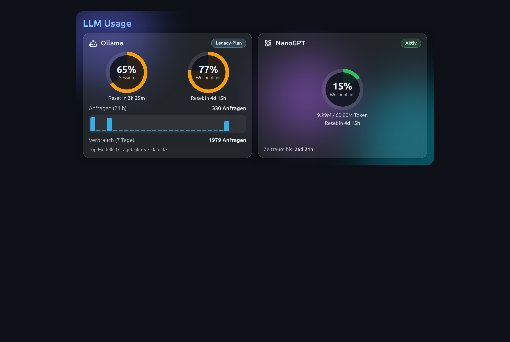

# LLM Usage Monitor

**[English](README.md)** · [Deutsch](README_DE.md)

Monitor your **Ollama** cloud and **NanoGPT** subscription usage limits directly in Home Assistant — session and weekly limits, credits balance, token quotas, reset countdowns and usage history, rendered on a beautiful glassmorphism dashboard card.

## Features

### Ollama (legacy plans — session & weekly limits)

- **Session limit** ring with used percent and live reset countdown
- **Weekly limit** ring with used percent and live reset countdown
- Purchased credit balance as sensor attribute

### Ollama (credit plans)

- **Credits balance** (USD) with allowance, percent used and monthly period countdown
- Automatically detected from the API response structure — no configuration needed

### Ollama (all plans)

- **Requests in the last 24 hours** with hourly sparkline
- **Usage over the last 7 days** — USD cost on credit plans, request count on legacy flat-rate plans — with top-model breakdown

### NanoGPT

- **Weekly input token quota** — used / remaining / percent, reset countdown
- Daily token ring only if your subscription actually has a daily quota (most don't — the card hides it automatically)
- Subscription state badge, billing period countdown and **degraded** warning

### Card

- **Auto-registered Lovelace card** — no manual resource setup, served directly from the integration directory with cache-busting version parameter
- **Auto-discovers its sensors** — no hardcoded entity IDs to maintain
- Works with **Ollama only, NanoGPT only, or both** — tiles appear and disappear automatically
- Multiple accounts supported (one config entry per key combination)
- Aurora / glassmorphism family design, animated background, progress rings, sparklines
- Localized in **English and German** (follows your Home Assistant language)
- Visual card editor with optional entity overrides
- Error banners per provider (invalid key, connection problems) rendered in the same design

## Security

Your API keys are treated as credentials, because they are:

- Keys are stored **only** in Home Assistant's config entry storage (`.storage/`, readable by the Home Assistant system only)
- The card and the frontend **never** receive keys — it renders sensor data exclusively
- Keys never appear in entity attributes, logs or error messages
- Home Assistant **diagnostics exports are redacted** automatically
- All unit tests use fake keys only; a dedicated test case proves that rejected keys never leak into exception messages

## Installation

### HACS (recommended)

1. Add this repository to HACS as a custom repository (category: **Integration**)
2. Install **LLM Usage Monitor**
3. Restart Home Assistant

### Manual

1. Copy `custom_components/llm_usage_monitor/` into your `<config>/custom_components/` directory
2. Restart Home Assistant

## Configuration

1. Go to **Settings → Devices & Services → Add Integration**
2. Search for **LLM Usage Monitor**
3. Enter one or both API keys:
   - **Ollama**: create an API key at [ollama.com](https://ollama.com) under Settings → API keys (optional)
   - **NanoGPT**: create an API key at [nano-gpt.com](https://nano-gpt.com) under Settings (optional)
4. At least one key is required; keys are validated live during setup

The poll interval can be changed in the integration's **Configure** (options) menu — default is 300 seconds. Ollama allows 10 requests per minute and NanoGPT 60 per API key, so even 60-second polling is safe.

## Card setup

Add a manual card to your dashboard and choose **LLM Usage Card** (type: `llm-usage-card`) — it finds its sensors automatically. Optional settings:

| Setting | Description |
| --- | --- |
| `title` | Card title (default: *LLM Usage*) |
| `entities.ollama` | Override the Ollama sensor entity (auto-discovery by default) |
| `entities.nanogpt` | Override the NanoGPT sensor entity (auto-discovery by default) |

## Sensors

| Entity | Description |
| --- | --- |
| `sensor.ollama_session_used` | Session limit used in % (legacy plans) |
| `sensor.ollama_weekly_used` | Weekly limit used in % (legacy plans) |
| `sensor.ollama_credits_balance` | Remaining included credits in USD (credit plans) |
| `sensor.ollama_requests_24h` | Requests in the last 24 hours |
| `sensor.ollama_usage_7d` | Usage over the last 7 days (USD cost on credit plans, request count on legacy flat-rate plans) |
| `sensor.nanogpt_weekly_tokens_used` | Weekly input tokens used |
| `sensor.nanogpt_daily_tokens_used` | Daily input tokens used (only if a daily quota exists) |
| `sensor.nanogpt_subscription` | Subscription state (diagnostic) |

Sensor attributes carry reset timestamps, remaining values, limits, degraded flags, sparkline buckets and top models — everything for history and automations.

## API sources

- Ollama: [Cloud usage](https://docs.ollama.com/api/cloud-usage) and [Balance](https://docs.ollama.com/api/balance) endpoints (official API keys)
- NanoGPT: [Subscription usage](https://docs.nano-gpt.com/api-reference/endpoint/subscription-usage) endpoint (official API keys)

## Requirements

- Home Assistant **2024.7** or newer

## License

[MIT](LICENSE)
